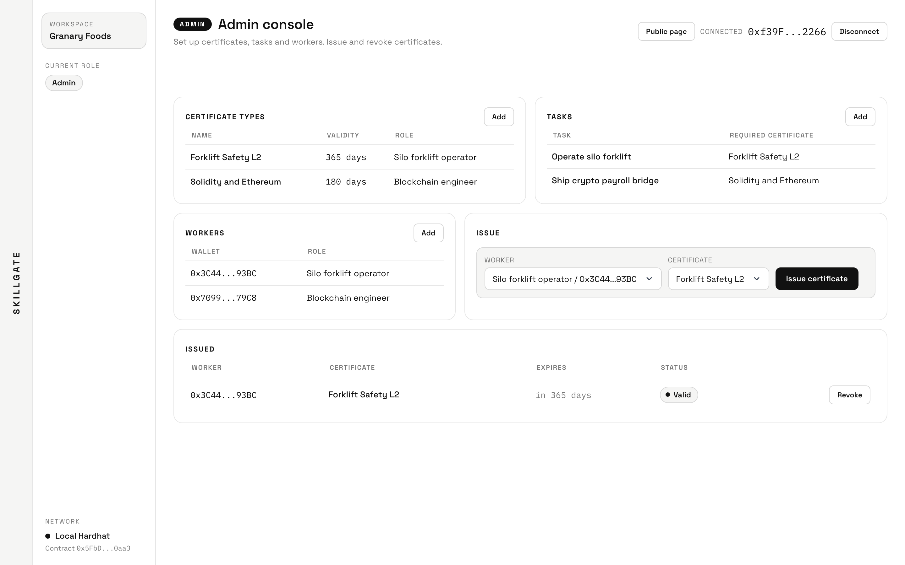

# SkillGate



SkillGate is a Sepolia dApp for role-scoped workforce certificates. A company deploys one contract, registers workers, defines certificate types, issues non-transferable credentials, and gates work behind valid credentials.

This project is built as an Alchemy Ethereum Bootcamp capstone-style product: Solidity contract logic, wallet-based writes, Alchemy Sepolia RPC, event-backed public reads, and a complete frontend.

## Product

- Public page at `/` verifies any worker wallet and shows recent on-chain activity read from contract events.
- Admin console at `/admin` registers workers, creates certificate types, creates gated tasks, issues certificates, and revokes certificates.
- Worker console at `/worker` lets registered workers pass a short on-chain quiz, self-claim a certificate by sending their own transaction, and start unlocked tasks.

Connecting a wallet from the public page routes you to the right console automatically based on your on-chain role (admin, worker, or not registered). The public verifier stays open to everyone. The app runs on Sepolia and prompts you to switch networks if your wallet is on another chain.

Certificates are self-claimed by the worker: the quiz answer is verified on-chain (the contract stores a keccak256 hash of the correct answers), so issuance needs no trusted server and the frontend holds no private key.

The default workspace is Granary Foods:

- Operator role: `Silo forklift operator`
- Engineer role: `Blockchain engineer`
- Operator certificate: `Forklift Safety L2`
- Engineer certificate: `Solidity and Ethereum`

## Deployed

- Network: Ethereum Sepolia
- Contract: `0x081555D1c8d13120D47FF9A2F3Dc5aaee1bc3223` ([Etherscan](https://sepolia.etherscan.io/address/0x081555D1c8d13120D47FF9A2F3Dc5aaee1bc3223#code), source verified)
- Deploy block: `11935649`
- Admin and issuer: `0x608Ad3e991d33bEFbc92E588567C6604028001da` (handed over by the deploy script; the deploying key keeps no rights)
- Walkthrough transactions, signed in MetaMask (MetaMask sent them through its smart-account delegation, so on Etherscan they appear as calls via MetaMask's delegation contract, with SkillGate's events in the logs): engineer claim [`0xd609…0cc8`](https://sepolia.etherscan.io/tx/0xd609ee563f6bfd7d2a8d9bbab3840b60cfc776ee0fd79717f587e1e8eee90cc8), task start [`0x7942…9302`](https://sepolia.etherscan.io/tx/0x79421d15aa28319fec14abbfe9045036a9e4770cdbb71e74fdd24292e2c69302), admin revoke [`0x2a23…161a`](https://sepolia.etherscan.io/tx/0x2a2382f1296155057cdb06b01bebeacaddee67a3a053e6d9abe317196eca161a)
- Earlier deployments (`0x36e7…D527` with older code, and test deployments made while recording the walkthrough) are no longer used. Contracts are immutable, so they stay on chain.
- There is no hosted web app. Run the app locally (see Run).

## Stack

- Next.js 16, React 19, wagmi, viem
- Solidity 0.8.35, OpenZeppelin, Hardhat 3
- Alchemy Ethereum Sepolia RPC
- MetaMask injected wallet connection

## Wallets

Use three MetaMask accounts from the same wallet:

- A4: deployer, admin, issuer
- A3: engineer worker
- A5: operator worker

A4 needs enough Sepolia ETH to deploy the contract and seed the workspace. A3 and A5 each need a little Sepolia ETH to self-claim their certificate and to start tasks (both are real transactions sent from the worker's own wallet).

## Alchemy

Install and authenticate the Alchemy CLI:

```bash
pnpm dlx @alchemy/cli@latest auth login
```

List existing apps:

```bash
pnpm dlx @alchemy/cli@latest app list --all --json
```

Create the Sepolia app:

```bash
pnpm dlx @alchemy/cli@latest app create --name "SkillGate Sepolia" --networks ETH_SEPOLIA --description "SkillGate certification capstone"
```

If the CLI reports a different Sepolia network id, check the available ids:

```bash
pnpm dlx @alchemy/cli@latest app chains --json
```

Use the app's Ethereum Sepolia HTTP endpoint as:

```bash
https://eth-sepolia.g.alchemy.com/v2/YOUR_ALCHEMY_KEY
```

## Environment

Create `.env`:

```bash
cp .env.example .env
```

Set:

```bash
SEPOLIA_RPC_URL=https://eth-sepolia.g.alchemy.com/v2/YOUR_ALCHEMY_KEY
NEXT_PUBLIC_ALCHEMY_SEPOLIA_RPC_URL=https://eth-sepolia.g.alchemy.com/v2/YOUR_ALCHEMY_KEY

SEPOLIA_PRIVATE_KEY=0xA4_PRIVATE_KEY

OPERATOR_ADDRESS=0xA5_OPERATOR_ADDRESS
ENGINEER_ADDRESS=0xA3_ENGINEER_ADDRESS

NEXT_PUBLIC_SKILLGATE_ADDRESS=0x0000000000000000000000000000000000000000
NEXT_PUBLIC_SKILLGATE_DEPLOY_BLOCK=0
```

After deployment, replace `NEXT_PUBLIC_SKILLGATE_ADDRESS` and `NEXT_PUBLIC_SKILLGATE_DEPLOY_BLOCK` with the values printed by the deploy script.

## Run

Install dependencies:

```bash
pnpm install
```

Run checks:

```bash
pnpm test
pnpm lint
pnpm build
```

Deploy to Sepolia:

```bash
pnpm deploy:sepolia
```

Optional: `NEW_ADMIN_ADDRESS` hands the workspace to another wallet after setup (the deploying key authorizes it as issuer, removes its own issuer right and transfers ownership), and `MAX_PRIORITY_FEE_GWEI` sets a low priority fee for cheap testnet deploys.

Start locally:

```bash
pnpm dev
```

Open the printed localhost URL.

## Demo Flow

1. Connect A4 at `/` and you are routed to `/admin`; confirm the seeded certificate types, workers, tasks, and operator certificate.
2. Connect A3 at `/`; you land on `/worker`. Take the `Solidity and Ethereum` quiz, self-claim the certificate (a real transaction sent from A3), then start `Ship crypto payroll bridge`.
3. Connect A5 at `/worker` and confirm `Forklift Safety L2` already unlocks `Operate silo forklift` (seeded via the admin issuer path).
4. Open `/`, paste A4 or A3, and verify that the verifier result and activity feed reflect the live contract state.
5. Return to `/admin`, revoke a certificate, and confirm the public and worker pages show the revoked state.

## Contract Checks

The test suite covers:

- only authorized issuers can issue certificates
- role-mismatched issuance reverts
- expired certificates fail the gate
- revoked certificates fail the gate
- non-registered wallets fail the gate
- a worker with a valid certificate can start the gated task
- a worker can self-claim a certificate by passing the on-chain quiz
- a wrong quiz answer reverts the self-claim
- role-mismatched and unregistered self-claims revert


## Current capstone validation

The updated source passes 16 contract tests covering issuance, role boundaries, expiration at the exact deadline, renewal, revocation and task access. Revoked workers cannot restore their own certificates through the public quiz; an issuer can deliberately reissue. Changing a worker's role immediately invalidates old-role task access. The public verifier uses those same eligibility rules.

The UI waits for successful mined receipts, catches rejected/failed transactions, prevents duplicate submissions while confirmation is pending, and clears console state when the wallet account changes. Read failures show an explicit error and Retry instead of claiming no credentials or treating the wallet as unregistered. Recent activity reads a bounded 100-block window, refreshes incrementally, and never overlaps polls. The unused legacy server-signing API has been removed; claims use the worker wallet.

### Reproduce locally without personal keys

1. Run `pnpm exec hardhat node --network localValidation --hostname 127.0.0.1 --port 3151`.
2. In another terminal run `pnpm exec hardhat run scripts/validate-local.ts --network localRpc`.
3. Run `pnpm dev --hostname 127.0.0.1 --port 3152` and open http://127.0.0.1:3152.
4. The local wallet selector uses only public Hardhat fixture accounts. Exercise engineer quiz/claim/start, admin revoke, operator access and an unregistered wallet. Transactions stay on the loopback node. The rehearsal uses chain ID 11155111 to exercise the same Sepolia-only UI; it is not a public Sepolia deployment.

The fixture script writes an ignored `.env.local` and refuses to overwrite an unrelated existing file. Move that generated file aside before a production build. Local connectors require development mode, the explicit local flag and a loopback RPC; production uses the injected wallet.

### Review and submission boundary

The current contract above was deployed to Sepolia from a throwaway demo admin wallet, and the walkthrough video was recorded against it with the demo wallets. The earlier deployment predates these changes; SkillGate is not upgradeable, so it was replaced rather than updated. No web app is hosted, and no repository visibility change or certification submission was performed.

Quiz answers and their hashes are public, and answered transactions can be read on-chain. This verifies the application workflow, not independent competence or completion of regulated workplace training. A real deployment would require trusted assessment/attestation, issuer lifecycle controls and an independent security review. The current small workspace reads employee/certificate lists in full; larger deployments need pagination/indexing.

Alchemy's EVM certification requires the project name, GitHub URL, description and a video no longer than 5 minutes (up to 200 MB). The live URL is optional. Reviewing the prepared video, arranging reviewer access to the private repository and approving the final submission remain with the owner.
Source: https://university.alchemy.com/certifications/evm-chain
